# Enterprise AWS Bedrock Platform: Security Posture & Defense-in-Depth Specification

> **Architecture Overview:** Multi-Tenant Enterprise Generative AI & Model Context Protocol (MCP) Platform  
> **Source Repository:** [`terraform-aws-bedrock-enterprise-platform`](https://github.com/paulkanz/terraform-aws-bedrock-enterprise-platform)  
> **Target Frameworks:** NIST SP 800-53 Rev 5, CIS AWS Foundations Benchmark v3.0, HIPAA / HITECH (§164.312), SOC 2 Type II, HITRUST CSF v9.x / v11.x, FDA 21 CFR Part 11, OWASP LLM Top 10  

---

## 1. Executive Summary: Zero-Trust Defense Architecture

The security architecture of the Enterprise Bedrock Generative AI Platform is engineered upon a **Zero-Trust, 7-Layer Defense-in-Depth Model**. It guarantees that:
1. **No sensitive data (ePHI/PII) or AI prompt ever traverses the public internet** once ingested.
2. **Every layer operates under least privilege**—from AWS Organizations Service Control Policies (SCPs) down to container task execution roles.
3. **Audit trails are cryptographically immutable** and protected against administrative tampering.
4. **All data at rest and in transit is secured by customer-managed KMS encryption (CMK)** with automatic rotation.
5. **AI safety is natively integrated into inference pipelines**, preventing prompt injection, jailbreaks, and sensitive data leakage before LLM processing occurs.

```mermaid
graph TD
    subgraph L1["Layer 1: Governance & SCPs"]
        SCP1["US Region Lock"]
        SCP2["Audit Tamper Shield"]
        SCP3["Mandatory KMS CMK"]
        SCP4["Bedrock BAA Model Whitelist"]
    end

    subgraph L2["Layer 2: Edge & Perimeter"]
        WAF["AWS WAFv2 (Geo-Fencing + OWASP Top 10)"]
        ALB["Application Load Balancer (TLS 1.2/1.3 + Strict Inactivity Teardown)"]
    end

    subgraph L3["Layer 3: Zero-Trust Network"]
        VPC["Multi-AZ Isolated Private Subnets"]
        VPCE["AWS PrivateLink Interface Endpoints"]
        MESH["Service Connect Private East-West Mesh"]
    end

    subgraph L4["Layer 4: Compute & Container Supply Chain"]
        FARGATE["Serverless ECS Fargate MicroVMs"]
        ECR["Immutable ECR Repositories + Inspector CVE Scan"]
        SECRETS["AWS Secrets Manager (KMS CMK Scoped)"]
    end

    subgraph L5["Layer 5: AI Safety & Bedrock Guardrails"]
        GUARD["Bedrock Guardrails (PHI/PII Redaction + MRN Regex)"]
        INJECT["OWASP LLM Prompt Injection & Jailbreak Filters"]
        GROUND["Contextual Grounding & Relevance Verification"]
    end

    subgraph L6["Layer 6: Cryptographic Data Protection & WORM"]
        KMS["KMS Customer Managed Key (Annual Rotation)"]
        WORM["S3 Object Lock (7-Year Compliance Mode WORM)"]
        BACKUP["AWS Backup Vault Lock (Immutable Compliance Mode)"]
    end

    subgraph L7["Layer 7: Continuous SIEM & Threat Detection"]
        SEC_HUB["AWS Security Hub Centralized CSPM"]
        MACIE["Amazon Macie Automated ePHI Discovery"]
        GUARDDUTY["Amazon GuardDuty ML Threat Detection"]
        TRAIL["CloudTrail (SHA-256 Validation + Multi-Region)"]
    end

    L1 --> L2 --> L3 --> L4 --> L5 --> L6 --> L7
```

---

## 2. The 7 Pillars of Defense-in-Depth

### Layer 1: AWS Organizations Governance & Immutable SCPs
* **US Region Lock (`org_scp.tf`):** Restricts all AWS API calls exclusively to `us-east-1` and `us-west-2`, preventing unauthorized extraterritorial processing of sensitive records.
* **Audit & Security Shield (`org_scp.tf`):** Denies deleting, stopping, or updating CloudTrail, GuardDuty, AWS Config, or Bedrock Invocation Logging. Root or administrative credentials within member accounts cannot bypass this control.
* **S3 Public Lockdown (`org_scp.tf`):** Denies removing Account/Bucket S3 Block Public Access and denies bucket policies/ACLs granting public read/write access.
* **Mandatory KMS Encryption (`org_scp.tf`):** Rejects unencrypted EBS volumes (`ec2:Encrypted == false`) and unencrypted S3 uploads (`s3:x-amz-server-side-encryption != aws:kms`).
* **Bedrock AI Model Lockout (`org_scp.tf`):** Restricts LLM calls strictly to approved HIPAA BAA models (Claude 3.5 Sonnet, Claude 3.5 Haiku, Amazon Titan Embeddings) and locks guardrails against deletion.
* **MFA-Protected Operations SCP (`org_scp.tf`):** Denies destructive operations (`kms:ScheduleKeyDeletion`, `kms:DisableKey`, `s3:DeleteBucket`, `cloudtrail:DeleteTrail`) unless the caller's session authenticated with Multi-Factor Authentication (HITRUST Domain 10/11 - Control 10.b / 11.a).

### Layer 2: Edge & Perimeter Defense
* **US-Only Ingress Geo-Restriction (`waf.tf`):** Priority 0 Geo-Match rule strictly restricts inbound traffic to authorized US territories (`US`, `PR`, `VI`, `GU`), blocking international IP address scanning and reconnaissance at the perimeter (HITRUST Domain 08 / 18).
* **AWS WAFv2 Web ACL (`waf.tf`):** Deployed directly on the internet-facing Application Load Balancer. Includes:
  * AWS Managed Rules Common Rule Set (OWASP Top 10 vulnerabilities).
  * AWS Managed Rules Known Bad Inputs (SQL injection, path traversal, remote code execution).
  * Amazon IP Reputation List (blocks known scanners, botnets, and malicious proxies).
  * Rate-based limiting rule capping requests at 2,000 requests per 5-minute rolling window per IP.
* **Application Load Balancer (ALB) Hardening (`ecs_mcp_platform.tf`):**
  * `drop_invalid_header_fields = true` enabled (CIS AWS Benchmark 5.4).
  * `idle_timeout = 300` (5-minute inactive connection teardown per HITRUST 11.e).
  * Port 80 HTTP listener strictly issues an HTTP 301 permanent redirect to HTTPS Port 443.
  * Port 443 HTTPS listener enforces `ELBSecurityPolicy-TLS13-1-2-2021-06` (TLS 1.2 and TLS 1.3 only, modern AEAD cipher suites).
  * Target Group stickiness expires sessions after 900 seconds (15 minutes maximum inactivity per HITRUST 11.e).

### Layer 3: Zero-Trust Network Micro-Segmentation & PrivateLink
* **VPC Isolation (`network.tf`):** Multi-AZ deployment across private subnets. Compute workloads run strictly in isolated private tiers with zero direct public internet routing.
* **CIS 5.1 Default Security Group Closure (`network.tf`):** Default VPC security group has all ingress and egress rules revoked to prevent accidental exposure.
* **AWS PrivateLink Interface Endpoints (`network.tf`):** Dedicated VPC Endpoints for `bedrock-runtime`, `bedrock`, `sqs`, `logs`, and `monitoring`, plus Gateway Endpoint for `s3`.
* **Zero-Trust East-West Service Connect (`ecs_mcp_platform.tf`):** Private Cloud Map HTTP namespace (`enterprise-genai.internal`) providing mutual service discovery and isolated east-west container communication between Application services and the Internal MCP Gateway without public IP traversal.

### Layer 4: Compute Hardening, Container Supply Chain & Secrets Management
* **MicroVM Isolation (Serverless ECS Fargate):** Workloads execute on AWS Fargate serverless microVMs, eliminating shared host OS vulnerabilities, patch management lag, and SSH/bastion attack surfaces.
* **Immutable ECR Repositories (`ecs_mcp_platform.tf`):** Container images stored with `image_tag_mutability = "IMMUTABLE"` (NIST CM-2) and KMS CMK encryption to prevent software supply chain tampering.
* **Continuous CVE Scanning (Amazon Inspector):** Automated image scanning on push (`scan_on_push = true`) evaluates vulnerabilities against CVE feeds before deployment (NIST SI-2).
* **KMS-Encrypted Secrets Manager (`ecs_mcp_platform.tf`):** Application secrets, database passwords, and internal API keys are encrypted at rest with the KMS CMK and injected into containers via native `secrets` blocks, eliminating plaintext environment variables.
* **Role-Based Workload Identity (`ecs_mcp_platform.tf`):** Task execution role strictly scoped to ECR image pulls, Secrets Manager retrieval, and CloudWatch logging. Task roles scoped to Bedrock PrivateLink and S3 buckets. Zero static AWS credentials in workloads.

### Layer 5: AI Safety, Clinical Grounding & Bedrock Guardrails
* **Real-Time PHI/PII Redaction (`bedrock_guardrails.tf`):** Redacts `US_SOCIAL_SECURITY_NUMBER`, `NAME`, `EMAIL`, `PHONE`, and `US_ADDRESS` in real time before prompts reach foundation models.
* **Custom Medical Record Number (MRN) Regex (`bedrock_guardrails.tf`):** Automated blocking pattern for sensitive identifier numbers (`MRN-\d{6,10}`).
* **OWASP LLM Prompt Injection & Jailbreak Defense (`bedrock_guardrails.tf`):** High-strength filters blocking prompt attacks, model jailbreaks, and system prompt extraction.
* **Bedrock Contextual Grounding & Hallucination Defense (`bedrock_guardrails.tf`):** Enforces `GROUNDING` (threshold 0.75) and `RELEVANCE` (threshold 0.75) filters to guarantee generated outputs are strictly grounded in source enterprise documentation and relevant to queries.
* **Model Invocation Logging (`bedrock_guardrails.tf`):** Logs prompt inputs, completion hashes, token counts, and invocation latency to encrypted CloudWatch Log Groups and S3 audit storage.

### Layer 6: Cryptographic Data Protection, Legal WORM & Disaster Recovery
* **KMS Customer Managed Key (CMK) (`security_kms.tf`):** Annual automatic key rotation (`enable_key_rotation = true`) with scoped key policy across S3, SQS, Bedrock, Secrets Manager, Security Hub, Backup, and Macie.
* **S3 Object Lock (7-Year WORM Storage) (`storage_ingestion.tf`):** S3 bucket `clinical_docs` enforces Object Lock in `COMPLIANCE` mode with a mandatory 7-year retention period, meeting **FDA 21 CFR Part 11** electronic record retention rules. Records cannot be overwritten or deleted by any user or root account.
* **AWS Backup with Vault Lock (WORM) (`backup_disaster_recovery.tf`):** Daily automated backup plan with cold storage lifecycle (90 days) and 7-year retention. Enforces **AWS Backup Vault Lock** in Compliance mode, preventing early deletion of recovery points during ransomware or insider threats (HITRUST Domain 15 - Control 15.c / 15.d).
* **S3 Storage Security (`storage_ingestion.tf`):** 100% S3 Public Access Block; mandatory TLS 1.2+ condition; mandatory `aws:kms` server-side encryption; dedicated server access logging.
* **Message Ingestion & DLQ Security (`storage_ingestion.tf`):** SQS queues encrypted with KMS CMK; redrive policy moves poisoned messages to a Dead Letter Queue (DLQ) after 3 failed attempts with a 14-day retention window.

### Layer 7: Centralized CSPM, Continuous Auditing & ePHI Discovery
* **AWS Security Hub Centralized CSPM (`compliance_security_audit.tf`):** Automated posture assessment continuously evaluating resources against **CIS AWS Foundations Benchmark v3.0** and **AWS Foundational Security Best Practices**.
* **Amazon Macie Automated ePHI Discovery (`compliance_security_audit.tf`):** Continuous ML-driven discovery of unmasked ePHI/PII across S3 buckets with automated EventBridge alert routing to SecOps (HITRUST Domain 18 - Control 18.c).
* **IAM Access Analyzer (`compliance_security_audit.tf`):** Continuous mathematical analysis of S3, KMS, and IAM resource policies to identify and prevent unintended external access.
* **Cryptographically Verified CloudTrail & WORM (`compliance_security_audit.tf`):** Multi-region tracking with SHA-256 digital signature log file validation (`enable_log_file_validation = true`) and 1-Year S3 Object Lock compliance retention.
* **AWS GuardDuty Threat Intelligence (`compliance_security_audit.tf`):** Continuous ML monitoring analyzing VPC Flow Logs, CloudTrail, S3 data plane calls, and EBS malware scans.
* **EventBridge Automated Incident Routing (`compliance_security_audit.tf`):** Captures GuardDuty findings ($\ge 7.0$ severity), AWS Config drift, and Macie findings, routing incidents to KMS-encrypted SNS topics for automated triage.
* **Real-Time CIS Alarms (`compliance_security_audit.tf`):** Metric alarms for CIS 3.1 (Unauthorized API Calls), CIS 3.3 (Root Usage), CIS 3.4 (IAM Policy Changes), and CIS 3.10 (Security Group Modifications).

---

## 3. Regulatory Compliance Cross-Reference Matrix

| Regulatory Framework | Specific Requirement / Control | Implementation in Terraform Design |
| :--- | :--- | :--- |
| **HITRUST CSF v9.x / v11.x** | **Domain 15 (15.c / 15.d): Business Continuity & Disaster Recovery** | `aws_backup_vault.clinical_vault` + `aws_backup_vault_lock_configuration` (WORM Backup Lock) + `aws_backup_plan` (7-year retention). |
| | **Domain 08 & 18 (08.b / 18.b): Network Protection & Data Sovereignty** | `aws_wafv2_web_acl` US Geo-Match rule blocking non-US IP addresses at the perimeter. |
| | **Domain 10 & 11 (10.b / 11.a): Access Control & Multi-Factor Authentication** | `aws_organizations_policy.enforce_mfa_for_destructive_actions` denying destructive actions without MFA. |
| | **Domain 18 (18.c / 18.d): Automated Sensitive Data Discovery & Classification** | `aws_macie2_account` continuous sensitive ePHI discovery and EventBridge alert routing. |
| | **Domain 11 (11.e): Inactivity Session Termination** | `aws_lb.external` `idle_timeout = 300` and Target Group stickiness expiring sessions at 900s (15 min max). |
| **NIST SP 800-53 Rev 5** | **AC-3 / AC-4 (Access Enforcement & Information Flow Enforcement)** | Multi-AZ Private VPC, PrivateLink endpoints, Security Groups with default drop, IAM Task Roles with least privilege, IAM Access Analyzer. |
| | **AU-2 / AU-3 / AU-6 / AU-9 (Audit Events, Content, & Tamper Protection)** | Multi-region CloudTrail, SHA-256 log file validation, 365-day CloudWatch retention, S3 Object Lock WORM retention, SCP audit shield. |
| | **SC-8 (Transmission Confidentiality & Integrity)** | ALB TLS 1.2/1.3 policy, HTTP-to-HTTPS 301 redirect, ECS Service Connect private mesh, S3 policies rejecting non-TLS requests. |
| | **SC-13 (Cryptographic Protection)** | AWS KMS CMK with annual rotation, AWS Secrets Manager, S3 SSE-KMS, SQS SSE-KMS, CloudWatch log group CMK encryption. |
| | **SI-2 / SI-4 (Flaw Remediation & Information System Monitoring)** | Continuous CVE scanning on ECR via Amazon Inspector; AWS GuardDuty ML threat detection; VPC Flow Logs capturing ALL traffic. |
| **CIS AWS Foundations v3.0** | **2.1.2 (S3 Public Access Block Enabled)** | Enforced at bucket level and via AWS Organizations SCP across all buckets. |
| | **3.1 - 3.7 (Multi-Region CloudTrail & Validation)** | CloudTrail multi-region enabled, log validation enabled, CloudWatch integration configured. |
| | **3.1, 3.3, 3.4, 3.10 (CloudWatch Alarms for CIS Events)** | CloudWatch metric filters and alarms wired directly to KMS-encrypted SNS alert topics. |
| | **4.1 (VPC Flow Logs Enabled)** | VPC Flow Logs capturing ALL traffic into encrypted CloudWatch log group. |
| | **5.1 (Default SG Closes All Ingress/Egress)** | Default VPC security group strips all inbound/outbound rules. |
| | **5.4 (ALB Drops Invalid Headers)** | `drop_invalid_header_fields = true` configured on Application Load Balancer. |
| **FDA 21 CFR Part 11** | **§11.10(a) (System Validation & Protection of Records)** | S3 Object Lock in `COMPLIANCE` mode (7-year WORM storage for clinical records, 1-year for audit logs); immutable ECR container tags; AWS Backup Vault Lock. |
| | **§11.10(e) (Computer-Generated Time-Stamped Audit Trails)** | Dual-delivery CloudTrail with SHA-256 digest validation and Bedrock model invocation audit logs recording all prompt/completion hashes. |
| **HIPAA Security Rule & HITECH** | **§164.312(a)(1) (Access Control)** | IAM role isolation, Fargate serverless microVM execution, Secrets Manager credential injection, S3 public access block. |
| | **§164.312(a)(2)(iv) (Encryption and Decryption)** | KMS CMK encryption at rest across S3, SQS, CloudWatch, Secrets Manager, and CloudTrail. |
| | **§164.312(b) (Audit Controls)** | Multi-region CloudTrail, VPC Flow Logs, and Bedrock model invocation logging. |
| | **§164.312(c)(1) (Data Integrity)** | CloudTrail SHA-256 log file validation, S3 Object Versioning and Object Lock enabled. |
| | **§164.312(e)(1) (Transmission Security)** | TLS 1.2+ enforced via S3 bucket policies, ALB HTTPS listener, and ECS Service Connect private routing. |
| **SOC 2 Type II** | **CC6.1 / CC6.6 (Logical Access & Boundary Protection)** | AWS WAFv2 perimeter, VPC PrivateLink endpoints, ECS Service Connect, Security Groups. |
| | **CC6.7 (Data Transmission Protection)** | End-to-end TLS encryption with modern cipher suites. |
| | **CC6.8 / CC7.2 (Tamper Prevention & Anomaly Detection)** | AWS Security Hub centralized CSPM, SCP protecting security services, AWS GuardDuty continuous threat detection, EventBridge auto-remediation. |
| **OWASP LLM Top 10** | **LLM01: Prompt Injection & LLM02: Sensitive Info Disclosure** | AWS Bedrock Guardrails with PII/PHI redaction, MRN regex blocking, and prompt injection filters. |
| | **LLM06: Excessive Agency & LLM08: Vector Drift** | SCP restricting Bedrock models strictly to approved BAA models, scoped IAM task roles. |
| | **LLM09: Overreliance / Hallucination** | Bedrock Contextual Grounding & Relevance filters enforcing strict alignment with reference source documentation. |
